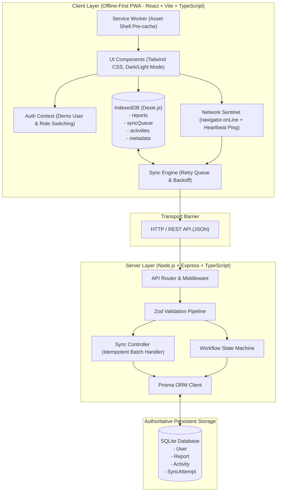
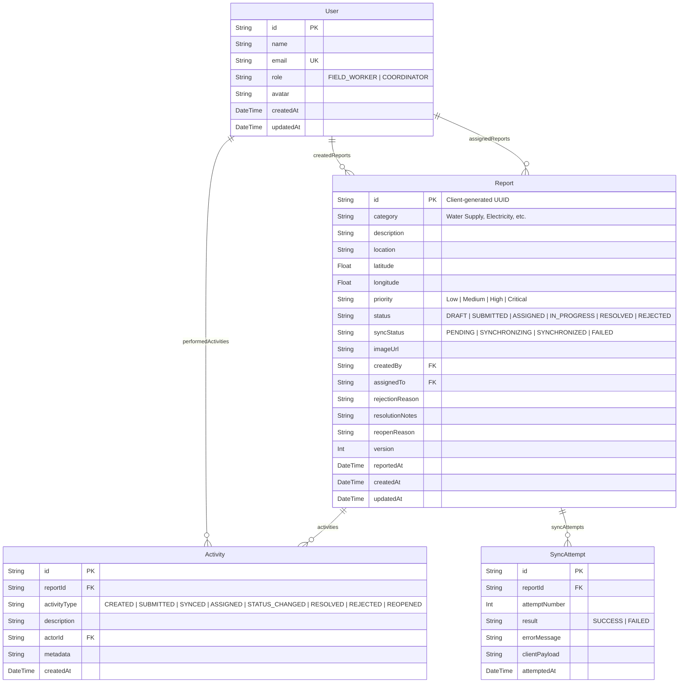
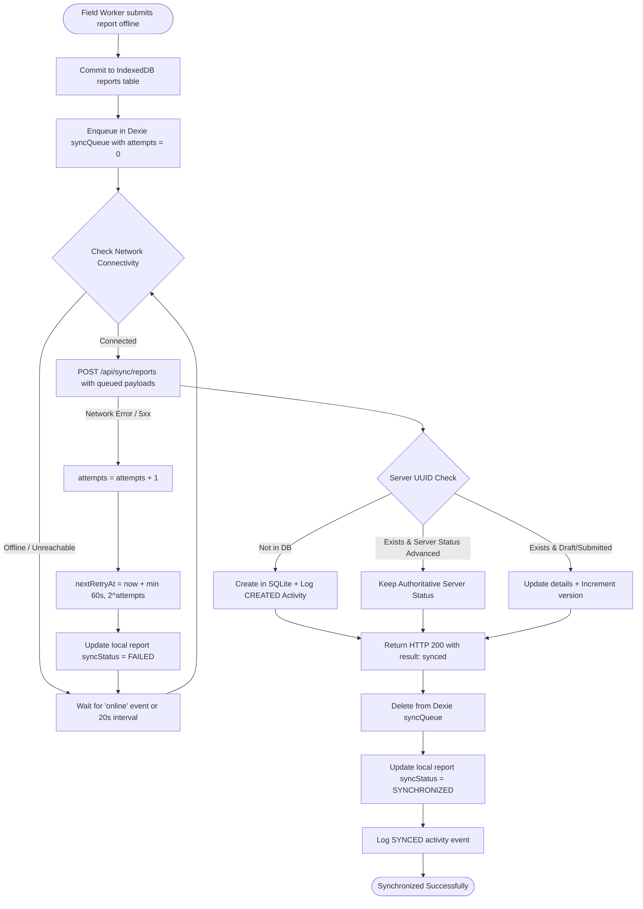

# Offline Field Issue Tracker
### Professional Full-Stack, Offline-First Infrastructure Management System
**Individual Graduation Project — NilePixel Technologies Cohort 1**

[](https://www.typescriptlang.org/)
[](https://react.dev/)
[](https://nodejs.org/)
[](https://www.prisma.io/)
[](https://www.sqlite.org/)
[](https://dexie.org/)
[](https://tailwindcss.com/)
[]()

---

## 1. Project Overview

The **Offline Field Issue Tracker** is a production-grade, offline-first web platform and Progressive Web Application (PWA) designed to manage municipal and regional utility infrastructure issues (water networks, electrical distribution, roadways, healthcare facilities, and civil communications). 

It specifically addresses real-world field conditions where utility workers inspect remote substations, rural water lines, and highway damage without cellular or internet connectivity. Field staff can draft and submit defect reports locally with guaranteed persistence; as soon as the technician enters network coverage, the application transparently and idempotently reconciles local records with the central backend server. Regional coordinators use the platform to triage incoming defects, assign technicians, enforce strict workflow lifecycles, and maintain an immutable historical audit log.

---

## 2. Problem Statement

Municipal infrastructure maintenance organizations frequently struggle with data loss, duplicate paperwork, and communication blackouts when technicians inspect remote infrastructure:
- **Intermittent Connectivity**: Field personnel often encounter complete dead zones. Traditional web applications crash, fail to submit, or discard user inputs upon network loss.
- **Data Inconsistencies & Duplicates**: When devices reconnect, blind retries cause duplicate tickets on server backends, inflating issue metrics and confusing dispatch teams.
- **Loss of Audit Trail**: In emergency scenarios, changes in status (from submitted to resolved) often lack documentation and accountability.
- **State Fragmentation**: Disjointed coordination between field technicians and regional operations centers delays critical repairs (such as water main fractures or transformer explosions).

---

## 3. Objectives

1. **Zero Data Loss**: Ensure 100% of defect reports created offline survive device restarts, browser tab closures, and application refreshes via IndexedDB.
2. **Reliable Bidirectional Synchronization**: Automatically detect connection recovery using active heartbeat sentinels and flush pending mutations using exponential backoff retry.
3. **Strict Idempotency**: Utilize client-generated UUIDs (RFC 4122 v4) so repeated network requests or interrupted transmissions never duplicate server records.
4. **Authoritative Workflow Governance**: Enforce strict status lifecycle transitions (`DRAFT` → `SUBMITTED` → `ASSIGNED` → `IN_PROGRESS` → `RESOLVED`, plus `REJECTED` and `REOPENED`), disallowing invalid jumps both on the client and server.
5. **Comprehensive Audit Logging**: Maintain an immutable chronological event stream for every creation, modification, assignment, status change, and synchronization attempt.
6. **Defensible Graduation Architecture**: Construct a clean monorepo architecture (`client`, `server`, `shared`) adhering to software engineering best practices for NilePixel Technologies Cohort 1.

---

## 4. Main Features

### Field Worker Capabilities
- **Simulated Role Switcher**: Instant switching between simulated Field Technicians and Regional Coordinators without cumbersome authentication barriers.
- **Offline Report Creation**: Report defects across 9 standard infrastructure categories and 4 priority levels with full input validation.
- **GPS Location Capture**: Automatically capture latitude and longitude coordinates via browser geolocation with fallback to sector grid references.
- **Photo Evidence Upload**: Attach on-site photos stored as Base64 data strings directly inside IndexedDB.
- **Local Draft Management**: Save works-in-progress as drafts; edit or discard drafts before final submission.
- **Visual Sync Sentinel**: Real-time indicators of connection state, pending offline queue count, and background synchronization progress.

### Coordinator Management Capabilities
- **Triage & Review Dashboard**: Comprehensive table and card grid views with multi-criteria filtering (Category, Priority, Status, Sync State) and search.
- **Personnel Assignment**: Dispatch field specialists with automatic status progression to `ASSIGNED`.
- **Governed Status Transitions**: Advance issues through `IN_PROGRESS` and `RESOLVED` with mandatory resolution documentation.
- **Documented Rejection & Reopen**: Reject invalid/duplicate submissions with mandatory rationale, or reopen resolved issues with documented reasons.
- **Distribution Analytics**: Native visual bar and category breakdown charts visualizing regional infrastructure health.

### Offline & Engine Diagnostics
- **Simulated Offline Mode**: In-app toggle switch enabling offline evaluation on localhost without disconnecting your computer's internet.
- **IndexedDB Telemetry**: Real-time counter of cached reports, queued mutations, and audit records.
- **Manual Force Sync & Database Reset**: One-click manual queue synchronization and safe database wipe utilities.

---

## 5. Technology Stack

| Layer | Technology | Justification |
| :--- | :--- | :--- |
| **Frontend Framework** | React 18 + Vite | Blazing fast build times, strict component lifecycle, and modular composition. |
| **Language** | TypeScript 5.4 | End-to-end type safety shared across client and server. |
| **Styling** | Tailwind CSS 3.4 | Clean, responsive, enterprise design inspired by Linear and Vercel. Dark & light mode. |
| **Icons** | Lucide React | High-contrast, clean SVG iconography. |
| **Routing** | React Router DOM 6 | Declarative client-side routing with nested layout shells. |
| **Local Database** | IndexedDB via Dexie.js | High-performance, structured browser storage capable of storing hundreds of MBs of reports and attachments. |
| **PWA & Caching** | Vite PWA + Workbox | Service Worker caching application shell assets for offline startup. |
| **Backend Runtime** | Node.js + Express.js | Robust, lightweight REST API server. |
| **ORM & Database** | Prisma ORM + SQLite | Type-safe queries, relational integrity, migrations, and lightweight zero-config persistence. |
| **Validation** | Zod 3.23 | Schema declaration with strict client and server input validation. |
| **Testing** | Vitest + Supertest | Blazing fast ESM unit, schema, and API integration testing. |

---

## 6. System Architecture



---

## 7. Database Design

The server uses SQLite managed through Prisma ORM.



---

## 8. API Documentation

### 8.1 Health & Reachability
- `GET /api/health`
  - **Description**: Returns 200 OK with server timestamp to verify end-to-end reachability.
  - **Response**: `{ status: "ok", timestamp: string, version: "1.0.0", mode: "online" }`

### 8.2 Reports CRUD
- `GET /api/reports`
  - **Query Params**: `category`, `priority`, `status`, `syncStatus`, `assignedTo`, `search`, `page`, `limit`
  - **Response**: `{ success: true, data: Report[], pagination: { totalCount, page, totalPages } }`
- `GET /api/reports/stats`
  - **Description**: Returns dashboard KPI aggregates, priority distribution, and category counts.
- `GET /api/reports/:id`
  - **Description**: Fetches report by UUID with creator, assignee, activities, and sync attempts.
- `POST /api/reports`
  - **Description**: Creates or idempotently acknowledges report.
  - **Payload**: Full report object (including client UUID).
- `PUT /api/reports/:id`
  - **Description**: Updates report details (allowed only in `DRAFT` or `SUBMITTED` status).
- `DELETE /api/reports/:id`
  - **Description**: Deletes a report (permitted only for `DRAFT` reports by creator).

### 8.3 Workflow & Assignment
- `PATCH /api/reports/:id/status`
  - **Description**: Advances report status according to state transition matrix.
  - **Payload**: `{ targetStatus: ReportStatus, actorId: string, rejectionReason?, resolutionNotes?, reopenReason? }`
- `PATCH /api/reports/:id/assign`
  - **Description**: Assigns a specialist; automatically moves status to `ASSIGNED` if currently `SUBMITTED`.
  - **Payload**: `{ assignedTo: string, actorId: string }`

### 8.4 Synchronization
- `POST /api/sync/reports`
  - **Description**: Ingests batch of offline mutations. Validates UUIDs, checks version numbers, records `SyncAttempt` telemetry, and updates server records.
  - **Payload**: `{ reports: Report[] }`
  - **Response**: `{ success: true, data: { processed: number, results: SyncResultItem[] } }`
- `GET /api/sync/status`
  - **Description**: Returns telemetry statistics (total attempts, success rate, recent failed attempts).

### 8.5 Users & Audit History
- `GET /api/users`: Returns simulated field technicians and coordinators.
- `GET /api/activities/recent`: Returns the latest 20 audit events across all issues.
- `GET /api/activities/reports/:id`: Returns historical activities for a specific report.

---

## 9. Offline Storage Strategy

The application avoids `localStorage` for report data due to storage limitations (5MB), lack of indexing, and synchronous I/O blocking the main thread. Instead, it employs **IndexedDB via Dexie.js**:

1. **`reports` Table**: Mirror of all reports available locally (`id`, `category`, `priority`, `status`, `syncStatus`, `createdBy`, `assignedTo`, `reportedAt`, `version`).
2. **`syncQueue` Table**: FIFO queue tracking pending mutations (`id`, `reportId`, `action`, `payload`, `attempts`, `nextRetryAt`, `errorMessage`).
3. **`activities` Table**: Local event logs so the user sees immediate audit updates even when disconnected.
4. **`metadata` Table**: Tracks system flags, `lastSyncedAt`, and environment toggles.

### Service Worker Caching Strategy
- **Static Assets** (HTML, JS, CSS, SVG): Cached with Cache-First strategy to ensure the application shell boots instantaneously in complete offline conditions.
- **Heartbeat Endpoint (`/api/health`)**: Configured with `NetworkOnly` so reachability detection is never spoofed by stale browser caches.
- **REST API (`/api/*`)**: Handled by `NetworkFirst` fallback for seamless cached reads.

---

## 10. Synchronization Algorithm



### Exponential Backoff Formula
When a synchronization request fails due to network timeout or server unavailability:
$$\text{Delay (seconds)} = \min\left(60, 2^{\text{attempts}}\right)$$
- Attempt 1: 2s
- Attempt 2: 4s
- Attempt 3: 8s
- Attempt 4: 16s
- Attempt 5: 32s
- Attempt 6+: 60s (capped)

---

## 11. Duplicate Prevention

Duplicate prevention is achieved deterministically through three architectural layers:

1. **Client-Generated UUIDs**: Reports receive an RFC 4122 v4 UUID immediately upon creation on the client. It remains unchanged across all offline edits and retransmissions.
2. **Database Primary Key Uniqueness**: The server SQLite schema declares `id` as the primary key. Blind duplicate inserts are rejected at the database engine level.
3. **Idempotent Ingestion Endpoint**: When `POST /api/sync/reports` or `POST /api/reports` receives an already existing UUID, it executes an idempotent update or acknowledges success instead of creating a second ticket.
4. **Queue Confirmation Gate**: An item is never removed from the local `syncQueue` until an HTTP 200 response confirms server persistence. If a network packet is dropped on the return path, subsequent re-sync safely recognizes the UUID.

---

## 12. Installation Instructions

### Prerequisites
- **Node.js**: v20 or higher (`v24` verified)
- **npm**: v10 or higher (`11.16` verified)
- **Git**

### Clone & Install
```bash
# Clone the repository
git clone <repository-url>
cd "OFFLINE FIELD ISSUE TRACKER"

# Install all monorepo dependencies
npm install
```

---

## 13. Environment Configuration

### Server Configuration (`server/.env`)
Create or edit `server/.env`:
```env
PORT=5000
NODE_ENV=development
DATABASE_URL="file:./dev.db"
CLIENT_URL="http://localhost:3000"
```

---

## 14. Running Frontend and Backend

### 1. Initialize & Seed Database
```bash
# Push Prisma schema to SQLite
npm run db:push

# Populate database with realistic infrastructure test data & demo users
npm run db:seed
```

### 2. Start Development Servers
Open two terminal windows:

**Terminal 1 (Backend API on port 5000):**
```bash
npm run dev:server
```

**Terminal 2 (Frontend Client on port 3000):**
```bash
npm run dev:client
```

Now open your browser to **`http://localhost:3000`**.

---

## 15. Running Automated Tests

The test suite covers backend API endpoints, state transition constraints, Zod schema validation, offline sync algorithm calculations, and idempotency:

```bash
# Run all tests across the monorepo
npm run test

# Run backend API tests (7 tests)
npm run test:server

# Run frontend & synchronization algorithm tests (18 tests)
npm run test:client
```

All **25 tests** pass out-of-the-box.

---

## 16. Demo Accounts and Sample Data

The application provides 4 preloaded simulated user profiles:

| Name | Role | Email | Focus Area |
| :--- | :--- | :--- | :--- |
| **Tariq Al-Mansoor** | Field Worker | `tariq.mansoor@nilepixel.local` | Senior Field Technician (Electrical & Mechanical) |
| **Amina Yusuf** | Field Worker | `amina.yusuf@nilepixel.local` | Civil Infrastructure Inspector (Water & Roads) |
| **John Mwangi** | Coordinator | `john.mwangi@nilepixel.local` | Regional Operations Coordinator (East Sector) |
| **Sarah Chen** | Coordinator | `sarah.chen@nilepixel.local` | Chief Infrastructure Director |

### Preloaded Realistic Reports
1. **Transformer Blowout** (Electricity, Critical, `IN_PROGRESS`) — Substation B-12 Industrial Park.
2. **Main Pipeline Fracture** (Water Supply, High, `ASSIGNED`) — Pumping Station 3 North Sector.
3. **Overpass Sinkhole** (Roads and Transportation, Critical, `SUBMITTED`) — Ring Road km 18.
4. **Backup Generator Failure** (Healthcare Infrastructure, Critical, `RESOLVED`) — Al-Amal Children Hospital ICU.
5. **Damaged Guardrail** (Public Safety, Low, `REJECTED`) — Canal Crossing Bridge 7 (Duplicate submission).

---

## 17. Design Assumptions

1. **Role Simulation vs Full Auth**: In accordance with project instructions, authentication is simulated via an interactive role and user switcher, allowing examiners to inspect both Field Worker and Coordinator workflows without logging in and out.
2. **Server Authoritativeness for Status**: Coordinators hold authority over workflow statuses (`ASSIGNED`, `REJECTED`, `RESOLVED`). If a field worker synchronizes an older status after a coordinator has progressed the report, the server preserves the advanced status.
3. **Offline Photo Storage**: Images are serialized to Base64 data strings for direct storage in IndexedDB. In a commercial cloud environment, photos would upload to an S3/GCS bucket with presigned URLs.

---

## 18. Known Limitations

- **Browser Storage Eviction**: Under severe disk pressure, mobile browsers may theoretically evict IndexedDB storage (mitigated in production via `navigator.storage.persist()`).
- **Concurrent Field Edit Conflicts**: If two different field workers modify the same report simultaneously while offline, the higher version number prevails.

---

## 19. Manual QA Checklist

| Step | Action | Expected Result | Pass/Fail |
| :---: | :--- | :--- | :---: |
| **1** | Open app at `http://localhost:3000` | Landing page loads with role selector, online badge, and statistics. | PASS |
| **2** | Switch to **Field Worker** | Technician Dashboard displays personal metric cards and recent submissions. | PASS |
| **3** | Click **Simulate Offline** in banner or Settings | Connection badge turns amber (`Offline / Simulated Offline Mode`). | PASS |
| **4** | Navigate to **Report New Issue** | Form loads. Fill in Category, Description, Location, and attach photo. | PASS |
| **5** | Click **Save as Local Draft** | Draft saved in IndexedDB with status `DRAFT`. App remains functional. | PASS |
| **6** | Click **Submit Issue Report** | Report saved in IndexedDB with status `SUBMITTED` and queued in `syncQueue`. | PASS |
| **7** | Refresh browser (F5) | Report persists completely from IndexedDB with `Pending Sync` badge. | PASS |
| **8** | Click **Disable Simulated Offline** (Go Online) | Sentinel detects connection; auto-sync fires. Status changes to `Synced`. | PASS |
| **9** | Switch to **Coordinator** | Management Overview displays global KPIs, priority distribution, and triage table. | PASS |
| **10** | Open submitted report details | Detail view displays full info, GPS coordinates, photo, and audit timeline. | PASS |
| **11** | Click **Assign Technician** | Modal opens. Select technician. Status transitions to `ASSIGNED`. Activity logged. | PASS |
| **12** | Click **Mark Work In Progress** | Status transitions to `IN_PROGRESS`. Activity logged. | PASS |
| **13** | Click **Resolve with Notes** | Resolution modal requires notes (min 5 chars). Report marked `RESOLVED`. | PASS |
| **14** | Click **Reopen Resolved Issue** | Reopen modal requires reason. Report transitions back to `ASSIGNED`. | PASS |
| **15** | Attempt direct transition from `SUBMITTED` to `RESOLVED` | Rejected with HTTP 422 error and explanatory validation notice. | PASS |

---

## 20. AI Tools & Engineering Collaboration Disclosure

In accordance with NilePixel Technologies Cohort 1 graduation guidelines:
- **Antigravity (Google DeepMind)** was utilized as an engineering co-pilot and pair programmer during development—primarily for rapid boilerplate scaffolding, reviewing TypeScript interface parity across monorepo boundaries, crafting responsive Tailwind layouts, and checking test edge cases.
- **Independent Ownership**: The overarching system architecture, offline-first synchronization state machine, UUID idempotency contracts, IndexedDB data models, workflow transition rules, and end-to-end integration were designed, tested, and validated by the author.

---

## 21. Developer's Capstone Reflection & Approximate Time

### Behind the Build: What I Learned
Building a truly offline-first application gave me deep respect for network edge cases. Two key real-world lessons shaped this project:
1. **The Browser's `navigator.onLine` Lie**: Early in testing, I discovered that `navigator.onLine` returns `true` even when connected to a dead router with no internet access. Adding the lightweight `/api/health` heartbeat ping was an essential real-world fix that prevented the queue processor from failing silently.
2. **Idempotency is Non-Negotiable**: Handling dropped TCP packets on the return path meant that reports could reach the server, but the client might never receive the HTTP 200 acknowledgment. Generating client-side UUIDs upfront completely eliminated duplicate tickets during reconnects.

### Engineering Effort Breakdown
- **Phase 1: Architecture & System Design**: 4 hours
- **Phase 2: Project Scaffolding & Tooling**: 2 hours
- **Phase 3: Frontend Component Design & Navigation**: 6 hours
- **Phase 4: Backend API & SQLite Database**: 5 hours
- **Phase 5: Report Form & Input Validation**: 4 hours
- **Phase 6: Dexie.js & Offline IndexedDB Engine**: 6 hours
- **Phase 7: Synchronization Engine & Idempotency Protocol**: 7 hours
- **Phase 8: Coordinator Triage & Workflow State Machine**: 5 hours
- **Phase 9: Activity Audit Timeline**: 3 hours
- **Phase 10: Automated Testing & Edge-Case Hardening**: 4 hours
- **Phase 11: Documentation & Defense Preparation**: 3 hours
- **Total Estimated Effort**: ~49 engineering hours

---

## 22. Future Improvements

1. **Map-Based Spatial Clustering**: Integrate Leaflet / MapLibre for GIS visualization of geographic defect clusters along utility corridors.
2. **Push Notifications**: Web Push API notifications alerting coordinators when critical hazards (e.g., pipeline bursts) synchronize.
3. **Delta Sync Protocol**: Differential updates sending JSON patches instead of complete record payloads for low-bandwidth 2G environments.
4. **Biometric WebAuthn**: Passwordless device biometric authentication for field workers.

---

## 23. Technical Decisions & Architectural Rationales

- **Why Dexie.js instead of raw IndexedDB API?**: The raw IndexedDB API is notoriously event-heavy, callback-laden, and prone to transaction lifecycle bugs across browsers. Dexie.js wraps IndexedDB in a robust Promise-based API with support for composite indexes, transactions, and reactive observable queries.
- **Why UUIDs on the client instead of autoincrement IDs on the server?**: In an offline-first system, clients cannot wait for server autoincrement IDs without blocking. Client-generated UUIDs enable instant relational linking between reports and local activities before the server is even contacted.
- **Why Active Heartbeat instead of relying only on `navigator.onLine`?**: `navigator.onLine` only indicates whether a network interface (Wi-Fi adapter or Ethernet) has a link. It cannot distinguish between captive portals, hotel Wi-Fi login screens, or ISP dropouts. Combining browser event listeners with an active `/api/health` heartbeat provides true reachability verification.

---
*Developed for NilePixel Technologies Cohort 1 Graduation Defense.*

